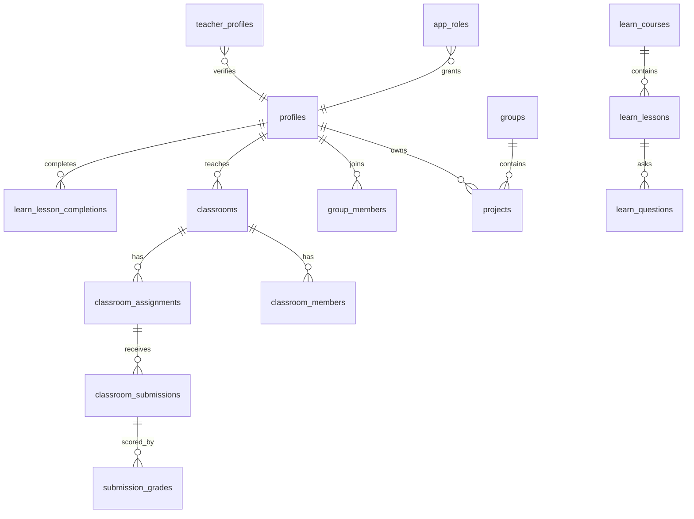

# Database and row level security

Migrations `supabase/migrations/0001` through `0012` are in the repository in numeric order. They were not applied to a database from this environment. `0013_close_privilege_gaps.sql` is new and **not applied**.

## Relationship sketch

Cloud IDE tables (`0001`) grant `authenticated` `SELECT` only. Later classroom and learn tables rely on Supabase default grants plus RLS. Policies are the gate only when those grants exist. This repo does not re-grant every classroom table explicitly.

## Policies that hold

- `learn_questions.answer` is revoked from `anon` and `authenticated` (`0004`). Grading uses the service role.
- `app_roles` has select-own and no insert/update policy for the user JWT.
- Project documents have no authenticated policy. The server writes them with the service role.
- Auth callback and profile API do not trust a client role string.

## Gaps (code review, not executed against production)

| ID | Table | Issue |
| --- | --- | --- |
| OT-006a | `profiles` | `0011` adds "any authenticated user can select every profile", which ORs with the narrower `0001` policy. Email and phone are readable. |
| OT-006b | `profiles` | Owner `UPDATE` includes `email`. `invite_to_project` looks up `profiles.email`. |
| OT-006c | `learn_questions.explanation`, `learn_lessons.expected_output` | Public select. Seed explanations restate the answer (`src/lib/learn/initialData.ts`). |
| OT-006d | `classroom_assignments.hidden_test_cases` | Members can select the whole row. The API strips the field. PostgREST does not. |
| OT-006e | `classroom_submissions` | Insert check does not force `grade` null or require enrollment. |
| OT-006f | `classroom_audit_logs`, `execution_logs`, `submission_snapshots`, `assignment_code_versions` | Insert policies allow a normal user to forge rows. The app writes with the service role. |
| OT-006g | `learn_lesson_completions`, `learn_question_attempts` | User insert can set `is_correct` and mark any lesson complete. The API writes with the service role after grading, but the policy is a second path. |
| OT-006h | storage `avatars` | Public bucket. Policies are inside `exception when others then null`, so a failure is silent. |

`0013` drops the broad profile select, revokes `UPDATE` on `email`, re-grants learn and assignment columns without answers and hidden tests, and drops the user insert policies above. Service-role writes bypass RLS and keep working. Apply it in Supabase. Do not run it blindly if a browser client selects `hidden_test_cases` or `explanation` directly. The Next.js student paths were updated to stop selecting those columns.

Cascading deletes, indexes, and unique constraints were read from the migrations and not load-tested. No destructive migration was executed.
